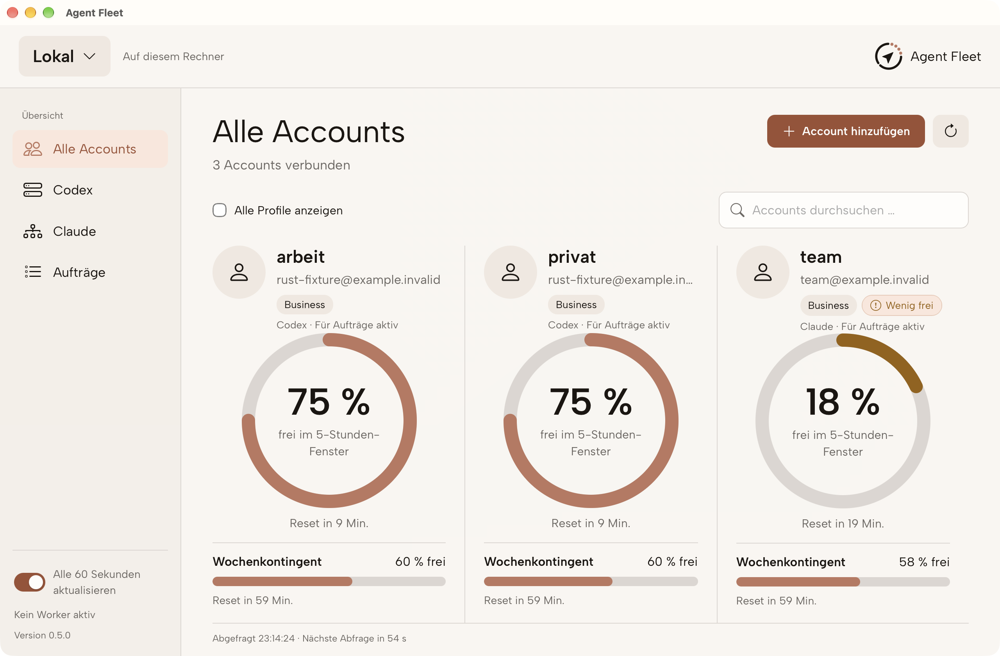

# Agent Fleet

**A personal task broker and account overview for Codex and Claude Code. Run locally or manage your own Linux pool over SSH.**

[Website](https://the-fin-at.github.io/agent-pool/) · [Quick start](docs/quickstart.md) · [Desktop](docs/desktop.md) · [Remote setup](docs/remote.md) · [CLI](docs/cli.md) · [Validation](docs/validation.md)

Agent Fleet selects an eligible profile of the provider you request, starts its official CLI and saves the result. A persistent queue waits for reported limits to reset. The desktop shows your accounts, usage observations, connections and login flows; jobs run through the CLI and agent skills.



## What it does

- Keep separate native logins for your own Codex and Claude Code accounts.
- Observe reported five-hour, weekly and model-specific usage windows. Missing observations remain unknown.
- Submit durable tasks with job IDs, idempotency keys and saved reports.
- Preserve explicit provider, model and profile choices. Ordinary unpinned jobs select an available account of the same provider.
- Connect to a user-selected Linux server through OpenSSH. Credentials and project files stay on the executing machine.
- Use the current Rust CLI and Tauri desktop without Python at runtime. Legacy Python sources remain for regression checks and older installations.

## Requirements and platform status

Build the CLI with Git and the Rust toolchain pinned in `rust-toolchain.toml`. Desktop builds also require Node.js 24 and the [Tauri platform prerequisites](https://v2.tauri.app/start/prerequisites/). Install the official native provider CLI for each provider you will execute on that machine and complete your own authorized login.

The CLI has macOS, Linux and Windows implementations; the desktop build targets macOS and Windows. A pure SSH client needs no local provider login. Native Windows installation/runtime acceptance remains open. Public macOS signing and notarization remain pending. Older release downloads contain the legacy Python/Tk application; build the current source for the Rust/Tauri version. See [validation](docs/validation.md) and [native packaging](docs/native-distribution.md).

## Install the CLI

On macOS or Linux, from a new checkout:

```sh
git clone https://github.com/the-fin-at/agent-pool.git
cd agent-pool
cargo build -p fleet-cli --release --locked
sh scripts/install_native.sh
export PATH="$HOME/.local/bin:$PATH"
agent-fleet doctor
```

On Windows, build with Rust/MSVC and run `scripts/install_native.ps1`; add the printed installation directory to your user PATH. For the desktop, follow [the desktop guide](docs/desktop.md).

For a new pool only:

```sh
agent-fleet init
agent-fleet login codex-1
agent-fleet quota refresh codex-1
```

`codex-1` is an example profile created by `init`, not a required account identity. Add only the profiles you need and complete the provider's official browser flow. Additional profiles and [existing Claude CLI login detection](docs/native-claude-default.md) are described in the setup guide. Existing installations keep the compatible `AgentPool` state directory; updates require the installer's explicit replace flag and retain a program backup.

## Run a task

In a project directory you select:

```sh
agent-fleet run --provider codex --cwd . --prompt "Explain this project without changing files."
```

For long-lived queued work, keep a worker running independently:

```sh
agent-fleet work
```

In another terminal:

```sh
agent-fleet job submit --provider codex --cwd . --prompt-file task.txt --key architecture-001
agent-fleet job get JOB_ID
```

Write the objective, project directory, file ownership and acceptance criteria in `task.txt`. File changes require `--allow-edits`. A completed submission is not a completed task: check its terminal status and actual result. `waiting` is unfinished; `needs_review` requires inspection before retry.

## Let your agent set it up

The portable [setup skill](skills/setup-agents-fleet/SKILL.md) guides installation, prerequisites and your own login. Copy `skills/agent-fleet` and `skills/setup-agents-fleet` into your personal Codex or Claude Code skill directory, preserving existing customizations. The native binary installer installs programs, not skills.

After setup, start a fresh agent session if needed and ask:

> Use the agent-fleet skill locally for this project. Have a Codex worker explain its architecture without changing files, and retrieve the report.

A remote project explicitly identifies its connection and registered server workspace. There is no machine-wide server default. [Remote setup](docs/remote.md) uses replaceable example names and your own SSH configuration.

## Data and limits

Native credentials, SQLite queue, reports and connections live in the current user's local state directory, outside the checkout. Keep that directory on a local disk. Multiple profiles of one verified account share its limits; they do not create extra provider capacity. The provider's subscriptions, usage charges and terms still apply.

Agent Fleet does not synchronize project files or credentials, and a pool is one user's trust boundary. Unknown resets are not invented. Other apps may consume the same account between observations. The desktop does not start a persistent task worker.

## Development and release checks

```sh
python3 scripts/check_portability.py --report test-results/portability.json
python3 -m unittest discover -s tests -v
cargo test -p fleet-core -p fleet-cli --locked
cargo build -p fleet-cli --examples --locked
cargo build -p fleet-cli --locked
python3 scripts/test_rust_compatibility.py
cd desktop
npm ci
npm test
npm run build
```

The [validation guide](docs/validation.md) separates controlled tests, opt-in host checks and platform acceptance. The [portability gate](docs/portability.md) inventories every source file and folder, verifies reviewed binary assets and rejects machine-specific examples or broken documentation links. Run reports belong in ignored `test-results/`.

Agent Fleet was previously named Agent Pool. The repository URL, compatibility command `agent-pool` and existing state directory names remain stable. THE-FIN branding and third-party license notices are intentional public product attribution. The source is currently designated proprietary in the manifests; public visibility does not grant an open-source license.
