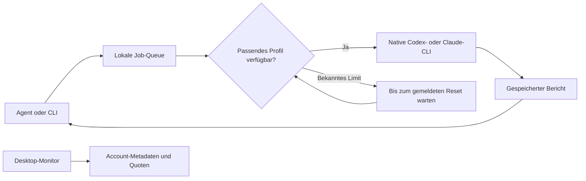

Agent Fleet hieß bis Version 0.2 Agent Pool. Der lokale Datenordner bleibt kompatibel; der optionale native Kompatibilitätsbefehl `agent-pool` verwendet denselben Rust-Kern. Der Installer legt standardmäßig `agent-fleet` an. Die Accounts müssen nicht neu angemeldet werden.

**Ein persönlicher Auftragsverteiler für Codex und Claude Code – lokal oder zentral auf Linux, mit Desktop-Manager für Mac und Windows.**

[Installation in 5 Schritten](docs/quickstart.md) · [Downloads](https://github.com/the-fin-at/agent-pool/releases/latest) · [Desktop](docs/desktop.md) · [Übersicht & Login](docs/overview-login.md) · [Linux-Server & Remote](docs/remote.md) · [CLI & Betrieb](docs/cli.md) · [Agenten-Skill](skills/agent-fleet/SKILL.md) · [Setup-Skill](skills/setup-agents-fleet/SKILL.md)

Ein Agent vergibt einen Auftrag. Agent Fleet wählt ein verfügbares Profil, startet die offizielle Provider-CLI und speichert den Bericht. Sind die gemeldeten Kontingente ausgeschöpft, wartet die Queue auf den tatsächlichen Reset. Die Desktop-App zeigt parallel, welche Accounts verbunden sind und wie viel Kontingent noch frei ist.

## Was drin ist

| | Funktion |
|---|---|
| **Mehrere Accounts** | Getrennte native Logins für eigene Codex- und Claude-Profile. |
| **Quoten beachten** | Fünf-Stunden-, Wochen- und zusätzliche Modellfenster anhand der gemeldeten Daten. |
| **Dauerhafte Aufträge** | SQLite-Queue mit Job-ID, Ergebnis und Schutz vor doppelter Einreichung. |
| **Desktop-App** | THE-FIN-Design, Kontingentkreise, Wochenbalken, Anbieterfilter, Suche und Abfrage alle 60 Sekunden. |
| **Zentraler Linux-Pool** | SSH-Clients, benannte Server-Workspaces, persistenter Worker, Lebenszeichen und Berichte. |
| **Agenten-Skill** | Ein gemeinsamer Ablauf für Auftrag, Worker, Ergebnis und Abnahme. |
| **Lokal bleiben** | Keine eigene OAuth-Implementierung, kein offener Netzwerkdienst, keine Credentials im Repository. |

Agent Fleet ist eine Auftragsschicht um die offiziellen CLIs. Es stellt keinen OpenAI-kompatiblen HTTP-Endpunkt bereit. Die Kontingente bleiben pro Account getrennt; die Anbieterbedingungen gelten weiter. Die [Bauentscheidung](docs/research-2026-10-28.md) erklärt den Vergleich mit CLIProxyAPI und tcr.

## Neu in 0.5.2: vorhandenen Claude-Login verwenden

Die lokale Übersicht erkennt deine bestehende normale Claude-CLI-Anmeldung automatisch als **Claude CLI**; ein erneuter Browserlogin ist dafür nicht nötig. Zusätzliche Accounts behalten ihre eigenen Anmeldeverzeichnisse. Profile derselben bestätigten Identität teilen Kontingent-/Busy-Grenzen; eine ausdrückliche Profilwahl bleibt verbindlich. Die normale CLI verwaltet Accountwechsel und Logout. [Verhalten, Nachweise und Rücknahme auf 0.5.1](docs/native-claude-default.md).

## Neuer Desktop

Die Seitenleiste filtert nach Codex und Claude. Die Kreise zeigen den freien Anteil im 5-Stunden-Fenster, die Balken das Wochenkontingent. Der obere Kontextwechsler trennt lokale Accounts und Remote-Verbindungen. Neue Accounts werden innerhalb der App angemeldet. Schrift und Icons liegen im App-Paket.


Die Rust-/Tauri-Umstellung ist im Quellstand enthalten. Ältere Downloads können noch die Python-/Tk-Version enthalten. Zum Bauen die [Desktop-Anleitung](docs/desktop.md) verwenden.

## Neu in 0.4: Übersicht und Login

Oben zwischen **Lokal** und **Remote** wechseln, einen Server öffnen und dort die verfügbaren Accounts sehen. Neue Verbindungen und native Codex-/Claude-Anmeldungen erfolgen innerhalb der App. Aufträge übernehmen Agenten über CLI und Skill. [Ablauf und Prüfstand](docs/overview-login.md).

## Neu: zentraler Server

Accounts einmal auf Linux anmelden, Worker dauerhaft betreiben und auf Mac/Windows denselben Pool verwalten:

```sh
agent-fleet remote add zentral --host pool-server --command /home/agentpool/.local/bin/agent-fleet --server-home /home/agentpool/.local/share/agent-pool
agent-fleet --remote zentral desktop
agent-fleet --remote zentral job submit --provider codex --workspace projekt --prompt-file auftrag.txt --key review-001
```

Voraussetzung ist die einmalige Servereinrichtung einschließlich SSH-Schlüsselzugang und registriertem Workspace. Die [vollständige Anleitung](docs/remote.md) beschreibt Installation, Headless-Login, systemd und Windows. Server und Clients aus demselben Quellstand bauen; ältere Release-Downloads enthalten die neue 0.4-Anmeldung noch nicht.

## Native Installation · Mac und Linux

Ab 0.5 laufen Dispatcher und CLI in Rust, der Desktop in Tauri 2 mit React und TypeScript. Die fertigen Programme brauchen kein Python, Node.js oder Cargo. Die offiziellen Codex-/Claude-CLIs bleiben separat installiert. Bestehende Accounts und Aufträge bleiben im bisherigen `AgentPool`-Verzeichnis; siehe [Migration und Prüfstand](docs/rust-migration.md).

Zum Bauen aus dem Quellstand: Git und die Rust-Version aus `rust-toolchain.toml`; für die Desktop-App zusätzlich Node.js 24 und die [Tauri-Systemvoraussetzungen](https://v2.tauri.app/start/prerequisites/).

```sh
git clone https://github.com/the-fin-at/agent-pool.git
cd agent-pool
cargo build -p fleet-cli --release --locked
sh scripts/install_native.sh
export PATH="$HOME/.local/bin:$PATH"
agent-fleet doctor
```

Bei einer vorhandenen Installation prüft der Installer zuerst die Ziele. `sh scripts/install_native.sh --replace` ersetzt die CLI und behält die vorige Datei als Backup. Er berührt keine Account- oder Auftragsdaten. Einen bestehenden Pool weiterverwenden; `init` nur bei einer Ersteinrichtung aufrufen.

```sh
agent-fleet init
agent-fleet login codex-1
agent-fleet quota refresh codex-1
```

Weitere eigene Accounts lassen sich mit `agent-fleet login codex-2` oder `agent-fleet login claude-1` anmelden. Im Browser jeweils den gewünschten Account wählen. Die [Setup-Anleitung](skills/setup-agents-fleet/SKILL.md) erläutert die nativen Anmeldungen und SSH-Verbindungen.

Für den Mac-Desktop aus demselben Checkout:

```sh
cd desktop
npm ci
npm run tauri build
cd ..
sh scripts/install_native.sh --desktop --replace
agent-fleet desktop
```

## Native Installation · Windows

Der Rust-Build benötigt die MSVC-Toolchain; der Desktop zusätzlich die [Tauri-Voraussetzungen](https://v2.tauri.app/start/prerequisites/#windows), darunter WebView2. Für die Verwendung fertiger Pakete sind die Buildwerkzeuge nicht erforderlich.

```powershell
git clone https://github.com/the-fin-at/agent-pool.git
cd agent-pool
cargo build -p fleet-cli --release --locked
.\scripts\install_native.ps1
# Den ausgegebenen bin-Ordner zum Benutzer-PATH hinzufügen.
cd desktop
npm ci
npm run tauri build
```

Die CLI heißt `agent-fleet.exe`, Desktop-Installer liegen unter `target\release\bundle`. [Plattformnachweise](docs/rust-migration.md) führen tatsächlich ausgeführte Prüfungen und offene Windows-Abnahme getrennt auf. Ältere `.pyz`-/`.pyzw`-Downloads enthalten weiterhin die Python-Version. Native Provider-`.exe` verwenden; npm-`.cmd`-/`.bat`-Shims sind keine nativen Providerprozesse.

## Einen Auftrag ausführen

Ein kurzer Leseauftrag, direkt im Projektordner:

```sh
agent-fleet run --provider codex --cwd . --prompt "Beschreibe die Architektur und nenne die drei wichtigsten Einstiegspunkte."
```

Für längere Aufgaben in einem Terminal den Worker laufen lassen:

```sh
agent-fleet work
```

In einem zweiten Terminal den Auftrag einreichen und die zurückgegebene Job-ID verwenden:

```sh
agent-fleet job submit --provider codex --cwd . --prompt-file task.txt --key architektur-001
agent-fleet job get <job-id>
agent-fleet job get <job-id> --result-only
```

`task.txt` enthält Ziel, Arbeitsverzeichnis, betroffene Dateien und Abnahmekriterien. Mit `--profile codex-2` einen Account festlegen; ohne diese Bindung wählt der Broker ein verfügbares Profil desselben Providers. `--model` wird an die native CLI weitergereicht.

Standard ist Lesen. Mit `--allow-edits` darf der Worker Dateien bearbeiten. Codex verwendet dafür seine `workspace-write`-Sandbox. Claude erhält `Read,Glob,Grep,Edit,Write`; seine Shell-Tools bleiben in dieser Version deaktiviert.

## Den Skill nutzen

Die Skills [`agent-fleet`](skills/agent-fleet/SKILL.md) und [`setup-agents-fleet`](skills/setup-agents-fleet/SKILL.md) können aus `skills/` in die persönlichen Skill-Verzeichnisse für Codex und Claude Code übernommen werden. Der native Binärinstaller installiert ausschließlich Programme. Der alte Python-Erstinstaller bleibt für ältere Versionen erhalten. Mit `$setup-agents-fleet` führt der Agent durch Installation/Update, lokale oder Remote-Einrichtung und native Browser-Anmeldungen. Bestehende Installationen werden nach Vergleich gezielt aktualisiert; der Erstinstaller überschreibt sie nicht. Danach bei Bedarf eine neue Agenten-Sitzung öffnen und beispielsweise beauftragen:

> Nutze den agent-fleet-Skill. Lass einen Codex-Worker die Architektur dieses Projekts untersuchen und hole seinen Bericht ab. Es sollen keine Dateien geändert werden.

Der Skill nutzt das lokal auffindbare Programm. Er setzt keinen persönlichen SharePoint-Sync-Pfad und keine fremden Account-Dateien voraus.

## Wie die Auswahl funktioniert



Codex-Quoten stammen aus dem dokumentierten nativen `account/rateLimits/read`. Claude-Quoten stammen aus gespeicherten CLI-Ereignissen oder einer manuell eingetragenen Beobachtung. Unbekannte Daten werden als unbekannt angezeigt. Ein bekannter Reset gilt erst dann für den Scheduler, wenn alle anwendbaren ausgeschöpften Fenster abgelaufen sind. Ein fehlender Reset wird nicht durch „in fünf Stunden“ ersetzt.

Verfügbare Profile mit dem frühesten bekannten Wochenreset erhalten bevorzugt neue Arbeit. Der erste Stand führt Jobs nacheinander aus. Bei unklaren Teil-Ausführungen oder Limits während eines Schreibauftrags folgt `needs_review`; eine Wiederholung ist dann explizit. [Betriebsdetails](docs/cli.md).

## Daten und Grenzen

- Jeder Nutzer meldet seine eigenen berechtigten Accounts lokal an. Bestehende Logins werden nicht kopiert; mehrere Logins desselben Accounts schaffen kein zusätzliches Kontingent.
- Quoten, Jobs und native Profile liegen im persönlichen lokalen State-Verzeichnis, außerhalb des Repositorys. Dieses Verzeichnis nicht über OneDrive/SharePoint synchronisieren.
- Der Desktop kann den bestehenden Codex-Hauptaccount zusätzlich anzeigen. Eine Anzeigequelle wird dadurch nicht automatisch für Pool-Aufträge aktiviert.
- Der Worker muss für automatische Wiederaufnahme laufen. Die Desktop-App zeigt Daten an und startet keinen Queue-Worker.
- Eine Quotenanzeige ist keine Reservierung. Andere Apps können denselben Account zwischen zwei Abfragen nutzen. Extra-Usage oder native Profilkonfiguration kann abrechnungsrelevant sein.

## Entwicklung und Prüfstand

```sh
cargo test -p fleet-core -p fleet-cli --locked
cargo build -p fleet-cli --examples --locked
cargo build -p fleet-cli --locked
python3 scripts/test_rust_compatibility.py
cd desktop
npm ci
npm test
npm run build
npm run tauri build
```

Python dient hier als unabhängige Referenz für bestehende Daten und RPC-Verträge. Die Produktionslaufzeit verwendet Rust. Die alten Python-Tests und Buildskripte bleiben für Regressionen und ältere Server erhalten. `native-rust-tauri` baut CLI und Desktop auf den jeweiligen Zielplattformen. Die konkrete lokale, native, SSH- und CI-Abnahme steht im [Migrationsnachweis](docs/rust-migration.md); ein alter Tk-Testlauf belegt keine Tauri-Oberfläche.

## Weiterführend

- [Installation und erster Test](docs/quickstart.md)
- [Desktop und Paketformate](docs/desktop.md)
- [CLI, Quoten, Fehler und Wiederanlauf](docs/cli.md)
- [Architektur und Recherche](docs/research-2026-10-28.md)
- [Prüfnachweis](docs/validation.md)

Realer Linux-Betrieb und drei Prüfschleifen auf `claw-remote`: [Einrichtung, Fehlerfälle und Messwerte](docs/claw-remote-validation.md).

0.4.2 liest Claudes native `unifiedWindows` für 5-Stunden- und Wochenlimits. [Vier echte Account-Aufträge und geprüfte Kontingentanzeige](docs/live-account-validation.md).

Der Agenten-Skill verwendet bei normalen Aufträgen automatische Profilwahl ohne `--profile`: volle 5-Stunden-/Wochenfenster werden berücksichtigt, alternative passende Accounts genutzt und nur bei fehlender Kapazität wartet der bestehende Auftrag. [Verhaltensvertrag und Tests](docs/agent-routing-contract.md). Das Ausführungsziel gilt pro Projekt: aus dem expliziten Auftrag, dem Chief-of-Staff-Projekthandoff oder dem für dieses Projekt klar festgelegten Ziel. Fehlt es oder ist es unklar, fragt der Agent vor der Übermittlung nach. Andere Projekte und vorhandene Verbindungen liefern keinen Standard; Remote-Aktionen benötigen explizit `--remote` und den passenden Server-Workspace.
