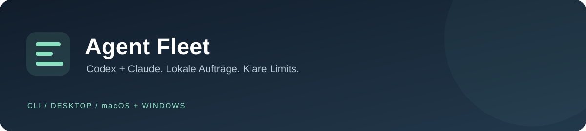
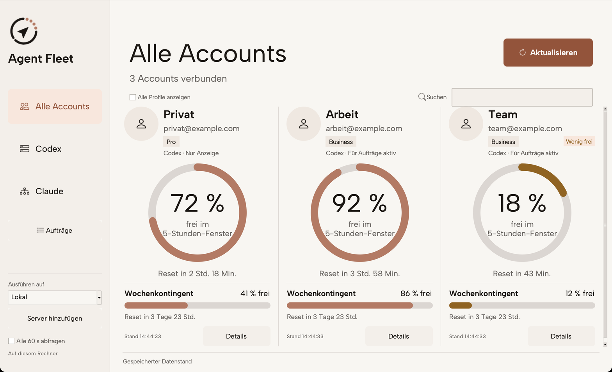
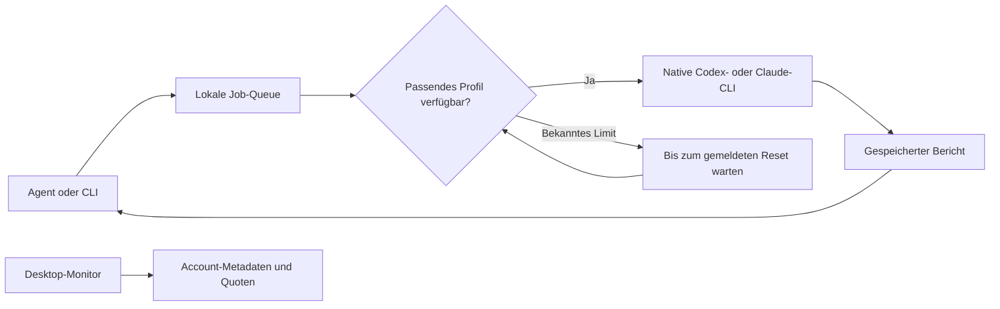

Agent Fleet hieß bis Version 0.2 Agent Pool. Der bisherige Befehl `agent-pool` und der lokale Datenordner bleiben kompatibel. Die Accounts müssen nicht neu angemeldet werden.

**Ein persönlicher Auftragsverteiler für Codex und Claude Code – lokal oder zentral auf Linux, mit Desktop-Manager für Mac und Windows.**

[Installation in 5 Schritten](docs/quickstart.md) · [Downloads](https://github.com/the-fin-at/agent-pool/releases/latest) · [Desktop](docs/desktop.md) · [Linux-Server & Remote](docs/remote.md) · [CLI & Betrieb](docs/cli.md) · [Agenten-Skill](skills/agent-fleet/SKILL.md)

Ein Agent vergibt einen Auftrag. Agent Fleet wählt ein verfügbares Profil, startet die offizielle Provider-CLI und speichert den Bericht. Sind die gemeldeten Kontingente ausgeschöpft, wartet die Queue auf den tatsächlichen Reset. Die Desktop-App zeigt parallel, welche Accounts verbunden sind und wie viel Kontingent noch frei ist.

## Was drin ist

| | Funktion |
|---|---|
| **Mehrere Accounts** | Getrennte native Logins für eigene Codex- und Claude-Profile. |
| **Quoten beachten** | Fünf-Stunden-, Wochen- und zusätzliche Modellfenster anhand der gemeldeten Daten. |
| **Dauerhafte Aufträge** | SQLite-Queue mit Job-ID, Ergebnis und Schutz vor doppelter Einreichung. |
| **Desktop-App** | THE-FIN-Design, Kontingentkreise, Wochenbalken, Anbieterfilter, Suche und Abfrage alle 60 Sekunden. |
| **Zentraler Linux-Pool** | SSH-Clients, benannte Server-Workspaces, persistenter Worker, Lebenszeichen und Berichte. |
| **Agenten-Skill** | Ein gemeinsamer Ablauf für Auftrag, Worker, Ergebnis und Abnahme. |
| **Lokal bleiben** | Keine eigene OAuth-Implementierung, kein offener Netzwerkdienst, keine Credentials im Repository. |

Agent Fleet ist eine Auftragsschicht um die offiziellen CLIs. Es stellt keinen OpenAI-kompatiblen HTTP-Endpunkt bereit. Die Kontingente bleiben pro Account getrennt; die Anbieterbedingungen gelten weiter. Die [Bauentscheidung](docs/research-2026-10-28.md) erklärt den Vergleich mit CLIProxyAPI und tcr.

## Neuer Desktop

Die Seitenleiste filtert nach Codex und Claude. Die Kreise zeigen den freien Anteil im 5-Stunden-Fenster, die Balken das Wochenkontingent. Serverauswahl und Aufträge sind direkt erreichbar. Schrift und Icons liegen im App-Paket.



Der neue Desktop ist im Quellstand enthalten; veröffentlichte v0.2.0-Pakete zeigen noch die alte Oberfläche. Zum Bauen die [Desktop-Anleitung](docs/desktop.md) verwenden.

## Neu: zentraler Server

Accounts einmal auf Linux anmelden, Worker dauerhaft betreiben und auf Mac/Windows denselben Pool verwalten:

```sh
agent-fleet remote add zentral --host pool-server --command /home/agentpool/.local/bin/agent-fleet --server-home /home/agentpool/.local/share/agent-pool
agent-fleet --remote zentral desktop
agent-fleet --remote zentral job submit --provider codex --workspace projekt --prompt-file auftrag.txt --key review-001
```

Voraussetzung ist die einmalige Servereinrichtung einschließlich SSH-Schlüsselzugang und registriertem Workspace. Die [vollständige Anleitung](docs/remote.md) beschreibt Installation, Headless-Login, systemd und Windows. Server und Clients aus demselben Quellstand bauen; bestehende v0.2.0-Downloads enthalten die Remote-Erweiterung noch nicht.

## Schnellstart · Mac

Voraussetzungen: Python 3.11+, Git und die native [Codex-CLI](https://developers.openai.com/codex/cli). Claude ist optional; dafür die native [Claude-Code-CLI](https://code.claude.com/docs/en/setup) installieren.

```sh
git clone https://github.com/the-fin-at/agent-pool.git
cd agent-pool
python3 scripts/build_zipapp.py
python3 scripts/install_local.py
```

Falls `~/.local/bin` noch nicht im PATH liegt, für das aktuelle Terminal:

```sh
export PATH="$HOME/.local/bin:$PATH"
```

Profile anlegen, einen eigenen Account anmelden und die Verbindung prüfen:

```sh
agent-fleet init
agent-fleet login codex-1
agent-fleet quota refresh codex-1
agent-fleet doctor
```

Weitere Accounts mit `agent-fleet login codex-2` und `agent-fleet login codex-3` anmelden. Dabei im Browser jeweils den gewünschten Account wählen. Für Claude: `agent-fleet login claude-1`.

**Desktop:** [Mac-Paket herunterladen](https://github.com/the-fin-at/agent-pool/releases/latest), entpacken und `Agent Fleet.app` nach `~/Applications` kopieren. Per Doppelklick oder `agent-fleet desktop` öffnen. Das Mac-App-Paket enthält Python und Tk; das CLI braucht weiterhin Python. Architektur und genaue Voraussetzungen stehen in der [Desktop-Anleitung](docs/desktop.md).

## Schnellstart · Windows

Voraussetzungen: Python 3.11+ mit Tcl/Tk und Python-Launcher, Git sowie die native Codex-CLI. Für den Desktop genügen auch die in den [Downloads](https://github.com/the-fin-at/agent-pool/releases/latest) angebotenen Pakete; die Provider-CLI und eigene Logins werden je Rechner eingerichtet.

```powershell
git clone https://github.com/the-fin-at/agent-pool.git
cd agent-pool
py -3 scripts/build_zipapp.py
py -3 dist/agent-fleet.pyz init
py -3 dist/agent-fleet.pyz login codex-1
py -3 dist/agent-fleet.pyz quota refresh codex-1
py -3 dist/agent-fleet.pyz doctor
```

**Aktueller Download:** Das portable Windows-Paket (`.pyzw`, Python mit Tk erforderlich). Eine native Windows-EXE ist noch nicht veröffentlicht, weil der GitHub-Runner wegen Kontoabrechnung/Ausgabenlimit nicht gestartet wurde. [Details zum Prüfstand](docs/validation.md).

**Desktop:** Das Windows-Desktop-Paket vollständig entpacken. Bei einem nativen Build `Agent Fleet.exe` zusammen mit seinem `_internal`-Ordner behalten. Das portable `Agent Fleet.pyzw` benötigt Python mit Tk und startet alternativ mit `pyw -3 '.\Agent Fleet.pyzw'`.

Für die CLI kann unter Windows jeder folgende Aufruf von `agent-fleet` durch `py -3 dist/agent-fleet.pyz` ersetzt werden. Native Provider-`.exe` verwenden; npm-`.cmd`-/`.bat`-Shims werden nicht unterstützt. [Windows-Schritte und Builds](docs/quickstart.md#windows).

## Einen Auftrag ausführen

Ein kurzer Leseauftrag, direkt im Projektordner:

```sh
agent-fleet run --provider codex --cwd . --prompt "Beschreibe die Architektur und nenne die drei wichtigsten Einstiegspunkte."
```

Für längere Aufgaben in einem Terminal den Worker laufen lassen:

```sh
agent-fleet work
```

In einem zweiten Terminal den Auftrag einreichen und die zurückgegebene Job-ID verwenden:

```sh
agent-fleet job submit --provider codex --cwd . --prompt-file task.txt --key architektur-001
agent-fleet job get <job-id>
agent-fleet job get <job-id> --result-only
```

`task.txt` enthält Ziel, Arbeitsverzeichnis, betroffene Dateien und Abnahmekriterien. Mit `--profile codex-2` einen Account festlegen; ohne diese Bindung wählt der Broker ein verfügbares Profil desselben Providers. `--model` wird an die native CLI weitergereicht.

Standard ist Lesen. Mit `--allow-edits` darf der Worker Dateien bearbeiten. Codex verwendet dafür seine `workspace-write`-Sandbox. Claude erhält `Read,Glob,Grep,Edit,Write`; seine Shell-Tools bleiben in dieser Version deaktiviert.

## Den Skill nutzen

Der lokale Installer kopiert [`skills/agent-fleet`](skills/agent-fleet/SKILL.md) in die persönlichen Skill-Verzeichnisse für Codex und Claude Code. Danach bei Bedarf eine neue Agenten-Sitzung öffnen und beispielsweise beauftragen:

> Nutze den agent-fleet-Skill. Lass einen Codex-Worker die Architektur dieses Projekts untersuchen und hole seinen Bericht ab. Es sollen keine Dateien geändert werden.

Der Skill nutzt das lokal auffindbare Programm. Er setzt keinen persönlichen SharePoint-Sync-Pfad und keine fremden Account-Dateien voraus.

## Wie die Auswahl funktioniert



Codex-Quoten stammen aus dem dokumentierten nativen `account/rateLimits/read`. Claude-Quoten stammen aus gespeicherten CLI-Ereignissen oder einer manuell eingetragenen Beobachtung. Unbekannte Daten werden als unbekannt angezeigt. Ein bekannter Reset gilt erst dann für den Scheduler, wenn alle anwendbaren ausgeschöpften Fenster abgelaufen sind. Ein fehlender Reset wird nicht durch „in fünf Stunden“ ersetzt.

Verfügbare Profile mit dem frühesten bekannten Wochenreset erhalten bevorzugt neue Arbeit. Der erste Stand führt Jobs nacheinander aus. Bei unklaren Teil-Ausführungen oder Limits während eines Schreibauftrags folgt `needs_review`; eine Wiederholung ist dann explizit. [Betriebsdetails](docs/cli.md).

## Daten und Grenzen

- Jeder Nutzer meldet seine eigenen berechtigten Accounts lokal an. Bestehende Logins werden nicht kopiert; mehrere Logins desselben Accounts schaffen kein zusätzliches Kontingent.
- Quoten, Jobs und native Profile liegen im persönlichen lokalen State-Verzeichnis, außerhalb des Repositorys. Dieses Verzeichnis nicht über OneDrive/SharePoint synchronisieren.
- Der Desktop kann den bestehenden Codex-Hauptaccount zusätzlich anzeigen. Eine Anzeigequelle wird dadurch nicht automatisch für Pool-Aufträge aktiviert.
- Der Worker muss für automatische Wiederaufnahme laufen. Die Desktop-App zeigt Daten an und startet keinen Queue-Worker.
- Eine Quotenanzeige ist keine Reservierung. Andere Apps können denselben Account zwischen zwei Abfragen nutzen. Extra-Usage oder native Profilkonfiguration kann abrechnungsrelevant sein.

## Entwicklung und Prüfstand

```sh
python3 -m unittest discover -s tests -v
python3 scripts/build_zipapp.py
```

Desktop-Pakete auf dem jeweiligen Zielsystem bauen:

```sh
python3 -m pip install -r requirements-desktop-build.txt
python3 scripts/build_desktop.py
```

Der lokale Mac-Lauf besteht aus **55 erfolgreichen Tests**, einschließlich nativer Fenster- und Prozess-Tests. Das gebündelte Mac-Programm wurde mit echten Account-Metadaten geprüft. Der [Prüfnachweis](docs/validation.md) hält lokale, CI- und offene Live-Prüfungen getrennt. Die Workflows testen Mac, Windows und Linux; native Desktop-Builds werden zusätzlich über `desktop-build` gestartet.

## Weiterführend

- [Installation und erster Test](docs/quickstart.md)
- [Desktop und Paketformate](docs/desktop.md)
- [CLI, Quoten, Fehler und Wiederanlauf](docs/cli.md)
- [Architektur und Recherche](docs/research-2026-10-28.md)
- [Prüfnachweis](docs/validation.md)
